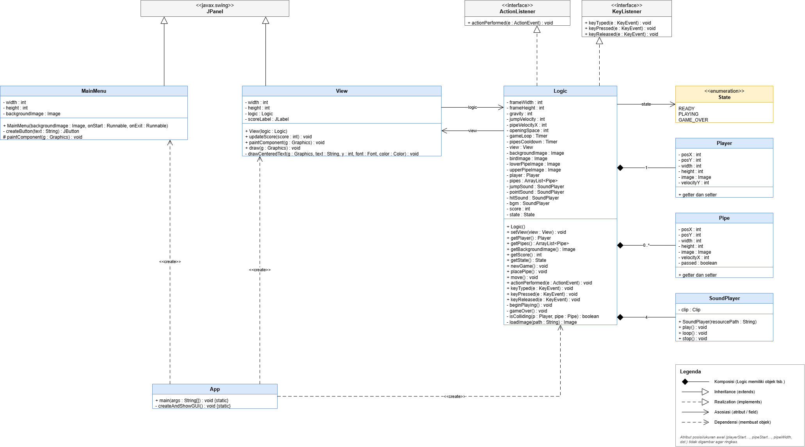
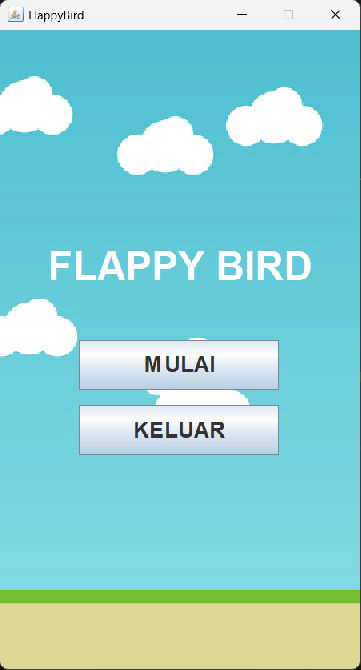
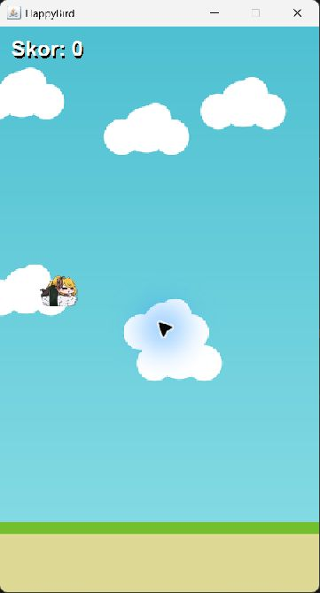
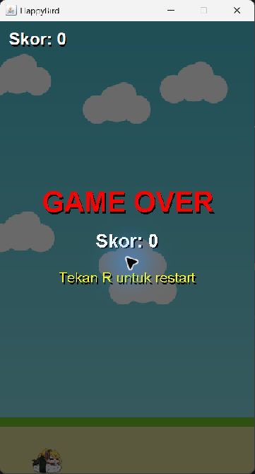

# TP6DPBO2526C1

Saya Muhammad Fadey Rafif dengan NIM 2504792 mengerjakan Tugas Praktikum 6 dalam mata kuliah Desain dan Pemrograman Berorientasi Objek untuk keberkahanNya maka saya tidak melakukan kecurangan seperti yang telah dispesifikasikan. Aamiin.

## Fitur

| Spesifikasi |
|---|
| Game Over saat menabrak pipa / jatuh ke batas bawah JFrame |
| Restart dengan tombol **R** setelah Game Over |
| `JLabel` untuk menampilkan skor |
| Skor +1 setiap melewati sepasang pipa |
| Main Menu (tombol **MULAI** & **KELUAR**) |
| Bonus: BGM + sound effect (lompat, skor, tabrakan) |

**Kontrol:** `SPASI` = lompat/mulai, `R` = restart (saat Game Over).

## Struktur Folder

```
TP6DPBO2526C1/
├── FlappyBird/
│   └── src/
│       ├── App.java
│       ├── Logic.java
│       ├── View.java
│       ├── MainMenu.java
│       ├── Player.java
│       ├── Pipe.java
│       ├── SoundPlayer.java
│       └── assets/        (gambar .png + audio .wav)
├── Dokumentasi/           (screenshot / video program berjalan)
└── README.md
```

## Desain Program

### Class Diagram



### Alasan Pemilihan Kelas & Atribut

- **`Player` & `Pipe`**: Murni berperan sebagai data class (cuma nyimpen posisi, ukuran, gambar, dan kecepatan). Keduanya sama sekali nggak ngurusin rendering visual atau logika game. Khusus di `Pipe`, ada atribut `passed` buat nandain pipa yang udah dilewatin biar skornya nggak kehitung double.
- **`Logic`**: Nah, ini "otak" dari game-nya. Class ini yang ngatur semua aturan main kayak gravitasi, pergerakan, collision detection, sampai perhitungan skor. Class ini pakai `ActionListener` buat jalanin game loop dan `KeyListener` buat baca input. Hubungan `Player` & `Pipe` ke sini itu **Composition**, karena hidup-matinya kedua objek itu dipegang penuh sama `Logic`.
- **`State`**: Daripada pusing kebanyakan flag boolean (kayak `isPlaying`, `isGameOver`), aku pakai enum (`READY`, `PLAYING`, `GAME_OVER`). Hasilnya flow game jauh lebih rapi dan aman dari bug kondisi yang tabrakan.
- **`View`**: Urusan front-end alias visual diserahin ke class ini. Tugasnya cuma nge-gambar (render lewat `paintComponent`) dan nyediain `JLabel` buat skor. Datanya dapet dari mana? Tinggal baca dari `Logic` lewat getter.
- **`MainMenu`**: Panel UI awal yang isinya tombol-tombol menu. Biar arsitekturnya loose coupling (dependensi longgar), action tombolnya di-passing lewat `Runnable`. Jadi, `MainMenu` nggak perlu tahu gimana cara mulai game-nya, yang penting dia ngirim trigger.
- **`SoundPlayer`**: Cuma wrapper buat `javax.sound.sampled.Clip`. Udah dibikin aman, jadi semisal file audionya corrupt atau gagal diload, game bakal tetep jalan normal walaupun tanpa suara (mute).
- **`App`**: Ini entry point-nya (class yang jalanin `main` method). Tugasnya cuma nge-inisialisasi frame, ngerangkai `Logic`, `View`, dan `MainMenu`, terus ngatur perpindahan layarnya pakai `CardLayout`.

## Penjelasan Alur

1. **Program dijalankan** → `App.main()` membuat `JFrame`, `Logic`, `View`, dan `MainMenu`. Layar pertama yang tampil adalah **Main Menu**.
2. **Klik KELUAR** → program berhenti (`System.exit(0)`).
3. **Klik MULAI** → `CardLayout` pindah ke layar game, `Logic.newGame()` mereset semuanya, state = `READY` (burung diam, muncul teks "Tekan SPASI untuk mulai").
4. **Tekan SPASI pertama** → state = `PLAYING`, BGM diputar, timer `pipesCooldown` mulai memunculkan sepasang pipa (atas & bawah) dengan tinggi celah acak setiap 1,5 detik. Burung ikut melompat.
5. **Game loop** (`Timer` ±60 FPS → `actionPerformed`) memanggil `move()` lalu `view.repaint()`. Di `move()`:
   - velocityY bertambah oleh gravitasi, posisi burung diperbarui (tidak boleh keluar batas atas);
   - semua pipa bergeser ke kiri;
   - **tabrakan** dicek per pipa (irisan persegi panjang);
   - jika `posX` pipa atas sudah lewat di belakang burung → **skor +1**, sound effect, `JLabel` diperbarui;
   - pipa yang sudah keluar layar dibuang;
   - jika burung menyentuh batas bawah JFrame → Game Over.
6. **Game Over** → state = `GAME_OVER`, `gameLoop` dan `pipesCooldown` dihentikan, BGM berhenti, sound tabrakan diputar, overlay "GAME OVER + skor + Tekan R untuk restart" tampil.
7. **Tekan R** (hanya saat Game Over) → `newGame()` dipanggil lagi: skor 0, pipa dibersihkan, burung kembali ke posisi awal (state `READY`).

## Dokumentasi

**Main Menu**



**Gameplay**



**Game Over**



**Video demo:** [Dokumentasi/demo.mp4](Dokumentasi/demo.mp4)

src image Kaela : https://id.pinterest.com/pin/kaela-kovalskia--1033013233268611942/